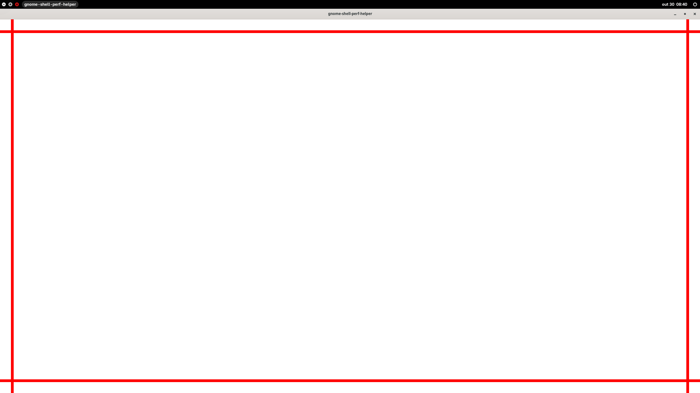
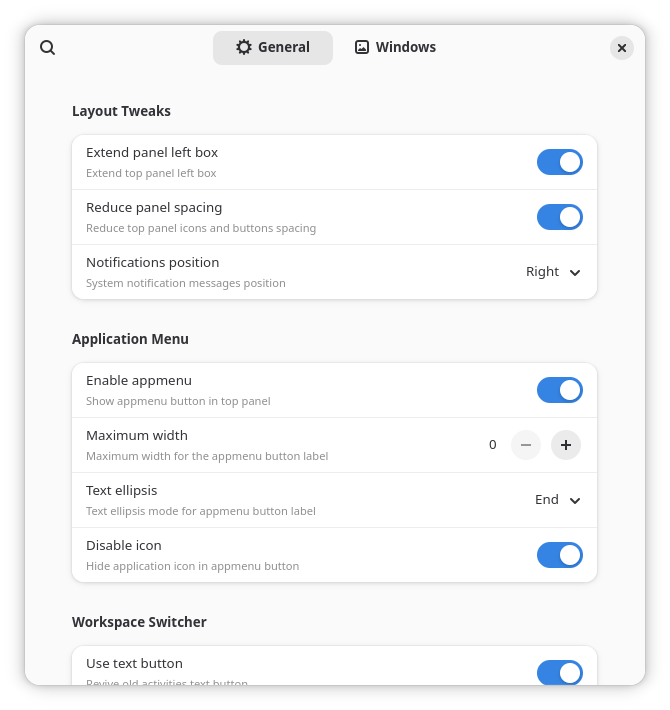

# Unite Next

Unite Next is an independent fork of [Unite Shell](https://github.com/hardpixel/unite-shell) for GNOME Shell 50 and 51. It adds window controls and titles to the top panel, manages window decorations, and provides configurable panel spacing, notifications and desktop labels.

The code, releases and issue tracker are public. This fork is independently maintained and is not endorsed by the upstream project. EGO submission preparation does not imply approval by extensions.gnome.org.



Native acceptance session with the GNOME performance-test client.



## Compatibility and installation

GNOME Shell 50 is the minimum supported version. The exact supported majors are listed in [metadata.json](unite-next@lucastsudaka.github.io/metadata.json). GNOME 49 and earlier are unsupported; future majors are added only after integration testing.

Disable the original Unite Shell before enabling Unite Next. They can be installed together, with independent settings, but must not run together. If the original activates later, Unite Next releases its effects, requests its own native deactivation and reports the conflict. Disable the original before re-enabling Unite Next. A rejected startup is reported by GNOME as an extension error; use native extension reload or a new session after resolving that conflict. Actual cleanup failures remain visible and require inspection.

XWayland decoration handling requires system Python 3 and libX11. GTK 3 and GTK 4 application styling remain supported. GTK file transactions run in GJS/GIO and require GNU coreutils 9.5 or later at `/usr/bin/{mv,ln,realpath,sync,timeout,dd}` and a filesystem supporting atomic exchange. The [GNU 9.5 announcement](https://lists.gnu.org/archive/html/info-gnu/2024-03/msg00006.html) documents the required `mv --exchange` option. Commands are individually bounded and never run through a shell. No third-party Python packages or runtime `xprop` are required.

When updating an existing `gtk.css`, Unite Next retains the actual displaced file in a private `.unite-next-gtk-recovery` directory beside it and logs the recovery path. This preserves concurrent edits, including writes through files an editor kept open. Conflicts fail visibly and retain both versions; this is not a filesystem compare-and-swap guarantee. No-op updates create no recovery files. Recoveries are never removed automatically: inspect/merge them after closing other editors, then remove versions you no longer need. An unsupported exchange fails visibly without falling back to an unsafe overwrite.

**Primary screen only** takes precedence over **Always** for window titles, panel controls, window decorations and panel click actions. GTK decoration styling applies to every application monitor, so it is disabled while **Primary screen only** is enabled. Turn that option off to use the selected GTK titlebar-hiding policy on all monitors. Disabling styling removes only fork-owned CSS; empty configuration files or directories may remain.

The XWayland helper uses raw Xlib to preserve exact `_MOTIF_WM_HINTS` values and compare-and-replace them under a server grab. GJS bindings do not expose the required mutation: GTK's [property-change API is unavailable to language bindings](https://docs.gtk.org/gdk3/func.property_change.html), and its [property-read API advises using Xlib directly](https://docs.gtk.org/gdk3/func.property_get.html). The helper is GPL source using system libraries; its supervisor kills and reaps the sole X11 worker after one second if the server stalls. Failures remain visible to the extension.

| Distribution | Runtime packages |
| --- | --- |
| Debian / Ubuntu | `python3 libx11-6 coreutils` |
| Fedora | `python3 libX11 coreutils` |
| Arch Linux | `python libx11 coreutils` |

Build this checkout using the dependencies below, then install its native extension ZIP:

```bash
/usr/bin/python3 tools/build.py package
gnome-extensions install --force build/unite-next-v1.zip
```

Enable Unite Next in GNOME Extensions. The filename follows the metadata version. Generated builds are not committed to Git. The existing [initial alpha release](https://github.com/lucastsudaka/unite-next/releases/tag/unite-next-v1) predates the feature removal in this source revision; its published assets remain unchanged. GitHub's separate **Source code** downloads contain the sources, while named extension ZIP assets are installable builds.

## Build and verify

Build and source verification tools are Git, system Python 3.9+, GJS, `gnome-extensions`, GNU gettext (`xgettext`, `msgcat`, `msgconv`, `msgmerge`, `msgfmt`, `msgattrib`, `msggrep`) and `glib-compile-schemas`. Isolated resource tests also use `dbus-daemon` and `gdbus`; preferences scenarios import the native GTK 4 and libadwaita libraries. Node.js and Yarn are not required.

From a clean source checkout:

```bash
/usr/bin/python3 tools/build.py check
/usr/bin/python3 -m unittest discover -s tests -p 'test_*.py' -v
/usr/bin/python3 tools/test-runtime.py
/usr/bin/python3 tools/build.py package
```

The output is `build/unite-next-v<metadata version>.zip`. The metadata integer version is the release authority; `--version VERSION` asserts an exact match. Packaging stages privately, checks the native archive and atomically replaces only the selected output. A failed validation preserves existing artifacts.

The archive includes runtime modules/resources, preferences, schema XML, compiled locale catalogs, LICENSE, NOTICE and applicable additional license texts. The GNOME installer compiles schemas. Sources retain the original PO catalogs and native build tools so the package can be rebuilt independently.

For an extensions.gnome.org submission, build the separate EGO channel:

```bash
/usr/bin/python3 tools/build.py package --channel ego
```

Its output is `build/ego/unite-next@lucastsudaka.github.io.shell-extension.zip`.
Only its metadata differs: the site controls `version`, so this channel omits that
field and uses the native version's decimal string as `version-name`. All other
payload bytes match the native package. Accept and identify the exact EGO ZIP on
both supported Shell majors before uploading; acceptance of a different ZIP does
not transfer automatically. [Reviewer notes](docs/ego-review.md) explain the runtime
boundaries, dependencies and remaining review discretion.

[Verification procedures](docs/public-verification.md) describe isolated native GNOME 50/51 acceptance, the conflict fixture, screenshot capture and the additional desktop-only dependencies. CI source/package checks supplement those native journeys.

[Development ownership](docs/development.md) locates implementation responsibilities,
focused scenarios and the verification levels used when changing a behavior.

## Source map and contribution

- `unite-next@lucastsudaka.github.io/extension.js`: native composition; `extension-lifecycle.js`: activation, ownership and upstream conflict handling.
- `panel.js`, `window.js`, `layout.js` in that directory: desktop managers; `panel-features.js`, `layout-features.js`, `button-widgets.js`: composed presentation and layout behavior.
- `window-policy.js`, `decorations.js`: window eligibility and decoration ownership; `x11.py`: bounded system-libX11 helper.
- `prefs.js`, `preferences-widget.js`, `preferences-bindings.js`, `settings.ui`: native GTK/Adwaita preferences.
- `resources.js`, `settings.js`, `features.js`, GTK and Shell style modules: explicit activation resource owners.
- `tools/`: native build, gettext and isolated verification entrypoints.
- `tests/`: normal, boundary and failure scenarios, including native compositor journeys.

Report issues and submit pull requests to [this repository](https://github.com/lucastsudaka/unite-next). Include GNOME version, relevant settings, reproduction steps and diagnostics. Run the checks for affected behavior; desktop-affecting changes require the native journeys described in the verification guide. Preserve unrelated user settings, GTK CSS and application-owned X11 properties.

Custom control themes live under `~/.local/share/unite-next/themes`. They must provide both variants and every close/minimize/maximize normal, hover and active asset. Optional `[Icons]` entries in `unite.theme` explicitly map intentionally shared artwork. An unavailable selection remains stored and visible in preferences; runtime reports use of the bundled default.

Explicit theme selections refresh discovery, including themes installed after activation. Control styles are confined to fork-owned actors; user theme files, UUID styling classes and relative asset paths remain unchanged. Imported control styles are scoped with their original resource bases. Invalid syntax or import graphs are reported rather than loaded without isolation.

After changing marked UI/JavaScript strings, run the native generator and parity check:

```bash
/usr/bin/python3 tools/translations.py generate
/usr/bin/python3 tools/translations.py check
```

Generation preserves existing human translations and leaves new untranslated messages explicit. Keep the current native tooling and source conventions.

## License and credits

Unite Next retains [GPLv3](LICENSE). [NOTICE](NOTICE) records the supplying upstream source, dated modifications and attribution. [Asset provenance](docs/asset-provenance.md) records the inherited artwork and the limits of available per-theme attribution.

Original Unite Shell contributors retain credit for their work. Upstream credits [Pixel Saver](https://github.com/deadalnix/pixel-saver), [TopIcons Plus](https://github.com/phocean/TopIcons-plus) and [Extend Left Box](https://github.com/StephenPCG/extend-left-box) as inspiration. Translator credits remain in the PO catalogs. Historical upstream changelog links describe upstream releases.
